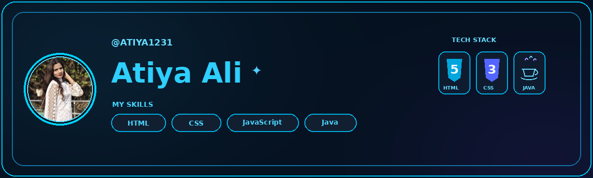

<h2 align="center">Hey, it's Atiya — somewhere between a dream and a system error.</h2>

  

---

## About

Learning new tech, chasing bugs & turning ideas into reality.  
Building things that speak for themselves.

---

---

## 🌐 Socials:
   

---

# 💻 Tech Stack:

### 👩🏻‍💻 Programming Languages

### 🗄️ Databases & Backend

### 🛠️ Tools & Platforms

### 🎨 Design & Analytics

### 🌐 Web Projects

</td>
</tr>
</table>

---

---

# 📊 GitHub Stats:
 
user=Atiya1231&background=0D1117&ring=22D3EE&fire=8B5CF6&currStreakLabel=22D3EE&sideLabels=C9D1D9&border=00C7FF) 
username=Atiya1231&theme=dark&hide_border=false&include_all_commits=false&count_private=false&layout=compact)

---

---

## 🐍 My GitHub Contributions
> 🐍 This snake animates my GitHub contribution history by eating my contributions!

<!-- Proudly created with GPRM ( https://gprm.itsvg.in ) -->
